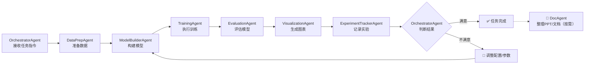

打造一个集成了**多智能体协作**的专业深度学习工作区。它结合了**标准化项目结构**的最佳实践与**多智能体系统**的自动化能力，能显著提升研发效率与实验可管理性。
下面我将为您提供一个完整的初始设计方案，涵盖**目录结构规划**、**核心Agent设计**及**协作流程**。
### 🧠 一、设计理念与核心原则
在开始前，明确几个核心设计原则，它们将贯穿整个工作区：
*   **关注点分离**：数据、模型、训练、评估、可视化等逻辑严格分离，降低耦合度，便于独立开发和替换。
*   **配置驱动**：所有超参数、路径、实验设置均通过配置文件管理，确保**可复现性**和**易切换性**。
*   **可复现性**：固定随机种子、记录完整的代码版本和运行环境，确保任何实验都能被精确复现。
*   **模块化与Agent专业化**：每个Agent（子智能体）职责单一、边界清晰，通过标准化接口进行协作，避免单个Agent过于复杂。
*   **自动化流水线**：通过Agent协作，自动完成从数据准备到结果分析的整个闭环，减少人工干预。

#### 协作与编码准则（贯穿项目全程）
以下准则约束所有Agent的行为；工作区落地后由WikiAgent将其同步进项目级`CLAUDE.md`正式生效：
*   **先逻辑后行动**：任何写入、修改、创建代码与文件的操作，必须先说明改动逻辑与依据、列出修改清单，经确认后方可执行。此为最高优先级准则，贯穿项目全程。
*   **有据则谏**：Agent不盲目顺从人类指令；在有逻辑、有依据时应主动提出建议乃至反驳，通过论证达成更优决策，最终裁量权归人类。
*   **角色化Skill**：根据实际场景为各Agent角色设计配套skill（存放于`.claude/skills/`，由WikiAgent维护），将可复用的操作流程沉淀为标准化能力。
*   **代码风格**：简洁、高效、易于理解三者兼顾——用更少的代码解决问题，不为一次性需求添加抽象与灵活性，可读性不向技巧妥协。
*   **必要注释**：代码须携带必要注释，说明**意图与依据**（为什么这么做），而非复述代码字面（做了什么）。

### 📁 二、深度学习工作区目录结构设计
以下是一个综合了数据科学最佳实践和深度学习工程化需求的推荐目录结构。它清晰地划分了不同功能的模块，为多Agent协作提供了物理基础。
```bash
deep_learning_workspace/
├── configs/                    # ⚙️ 配置中心
│   ├── default.yaml            # 默认基础配置
│   ├── experiment_1.yaml       # 特定实验配置（可覆盖默认值）
│   └── dataset/                # 数据集相关配置
│       └── cifar10.yaml
├── data/                       # 📊 数据存储区（原始、处理中、最终）
│   ├── raw/                    # 原始、不可变数据
│   ├── interim/                # 中间处理数据
│   ├── processed/              # 最终用于训练的规范数据
│   └── external/               # 第三方数据
├── docs/                       # 📝 项目文档
├── models/                     # 🏗️ 模型定义
│   ├── networks/               # 网络结构定义
│   ├── losses/                 # 自定义损失函数
│   └── pretrained/             # 预训练模型权重
├── notebooks/                  # 🧪 Jupyter探索性分析
├── papers/                     # 📄 论文与参考代码库（不入git）
│   ├── pdfs/                   # 论文原文PDF
│   └── repos/                  # 论文对应代码库拷贝，便于移植复现
├── outputs/                    # 📤 运行输出（自动生成）
│   ├── logs/                   # 训练日志
│   ├── checkpoints/            # 模型权重保存
│   ├── predictions/            # 推理预测结果
│   ├── metrics/                # 评估指标
│   └── reports/                # DocAgent生成的PPT与文档
├── scripts/                    # 🎯 核心可执行脚本
│   ├── train.py                # 训练入口
│   ├── evaluate.py             # 评估入口
│   ├── infer.py                # 推理入口
│   └── export_model.py         # 模型导出（如ONNX）
├── src/                        # 🧠 核心Python源代码
│   ├── data/                   # 数据处理模块
│   │   ├── datasets.py         # 自定义Dataset类
│   │   └── transforms.py       # 数据增强管道
│   ├── features/               # 特征工程模块
│   ├── models/                 # 模型构建模块
│   ├── training/               # 训练引擎模块
│   │   ├── trainer.py          # 训练循环
│   │   └── evaluator.py        # 评估逻辑
│   ├── inference/              # 推理引擎模块
│   ├── visualization/          # 可视化模块
│   │   └── plot_utils.py       # 绘图工具
│   └── utils/                  # 通用工具函数
│       ├── logger.py           # 日志记录
│       ├── config.py           # 配置加载
│       └── metrics.py          # 指标计算
├── tests/                      # 🧪 测试代码
├── .claude/                    # 🤖 Claude Code配置（WikiAgent维护对象）
│   ├── agents/                 # subagent定义（*.md）
│   └── skills/                 # skill定义
├── .gitignore                  # Git忽略文件
├── CLAUDE.md                   # 项目级AI协作准则（后期由WikiAgent维护）
├── README.md                   # 项目说明
├── requirements.txt            # Python依赖
└── pyproject.toml              # 项目元数据
```
#### 关键目录解析：
*   **`configs/`**：是项目的“大脑”。使用YAML文件分层管理配置，`default.yaml`定义基础设置，特定实验配置（如`experiment_1.yaml`）可继承或覆盖它，实现**配置与代码分离**。
*   **`data/`**：严格区分数据的生命周期阶段。`raw/`存放不可变原始数据，`processed/`存放最终可用于训练的规范数据，确保数据可追溯。
*   **`src/`**：包含所有核心Python模块，是Agent调用的工具库。
*   **`papers/`**：论文参考区。`pdfs/`存论文原文，`repos/`存论文对应开源代码库的完整拷贝，供复现与移植参考（需要时再将模块改写进`src/`，不在该目录内直接开发）。因PDF体积大、代码库自带独立版本来源（内嵌`.git`纳入后会产生子仓库引用问题），整个目录**不纳入版本控制**，在`.gitignore`中记录`papers/`。
*   **`outputs/`**：由训练脚本自动创建和写入，用于存放日志、模型、预测结果等，**不纳入版本控制**，保持项目整洁。
*   **`scripts/`**：作为命令行接口（CLI），是**人类操作者**或**调度Agent**的入口点，用于触发特定的任务（如训练、评估）。
### 🤖 三、多智能体团队设计与协作
基于上述目录结构，我们可以设计一个各司其职、协同工作的深度学习Agent团队。
#### 核心Agent角色定义
下表概述了团队中的核心Agent及其职责：
| Agent名称 | 职责描述 | 核心能力与工具 | 主要输入/输出 |
| :--- | :--- | :--- | :--- |
| **OrchestratorAgent** | **总调度**。接收高层任务，进行任务分解，分派任务给其他Agent，监控进度，整合最终结果。 | - 任务规划与分解<br>- Agent状态监控与通信<br>- 结果汇总与整合 | 输入：高层任务指令<br>输出：最终实验报告或部署模型 |
| **DataPrepAgent** | **数据准备**。负责数据下载、清洗、预处理、特征工程，生成可直接用于训练的数据集。 | - 调用`src/data/`模块<br>- 处理`data/`目录下的数据<br>- 执行数据验证与质量检查 | 输入：原始数据或配置<br>输出：处理后的数据集、数据统计报告 |
| **ModelBuilderAgent** | **模型构建**。根据配置定义模型架构，加载预训练权重，准备训练所需的模型组件。 | - 调用`src/models/`模块<br>- 解析模型配置<br>- 初始化优化器、损失函数 | 输入：模型配置<br>输出：初始化的模型、优化器、损失函数 |
| **TrainingAgent** | **训练执行**。负责完整的训练循环，包括前向传播、反向传播、优化器更新、指标监控、模型保存。 | - 调用`src/training/trainer.py`<br>- 使用TensorBoard/W&B记录日志<br>- 实现早停、学习率调度、模型检查点 | 输入：模型、数据、训练配置<br>输出：训练日志、模型权重、训练指标 |
| **EvaluationAgent** | **评估与推理**。对训练好的模型在测试集上进行全面评估，生成评估报告；或对新数据进行推理预测。 | - 调用`src/training/evaluator.py`<br>- 计算多种评估指标<br>- 生成可视化分析（如混淆矩阵） | 输入：模型、测试数据<br>输出：评估报告、指标、预测结果 |
| **VisualizationAgent** | **可视化专家**。将训练日志、评估指标、预测结果转化为直观的图表，用于分析和汇报。 | - 调用`src/visualization/`模块<br>- 生成训练曲线、指标对比图、预测样本可视化 | 输入：日志文件、指标数据<br>输出：图表（如PNG、PDF） |
| **ExperimentTrackerAgent** | **实验跟踪**。记录所有实验的超参数、环境、代码版本、结果指标，支持实验对比与搜索。 | - 集成MLflow/W&B等平台<br>- 自动记录实验元数据<br>- 提供实验查询与比较接口 | 输入：实验配置、结果<br>输出：结构化的实验记录库 |
| **DocAgent** | **文档与PPT制作**（按需调用）。将实验结果、指标图表或用户指定任务整理为汇报PPT与技术文档。 | - 运行于conda `base`环境<br>- 使用`python-pptx`、`python-docx`（或Markdown）<br>- 读取`outputs/metrics/`、图表与实验记录 | 输入：实验产物或用户任务说明<br>输出：PPT/文档（存至`outputs/reports/`） |
| **WikiAgent** | **对内文档维护**（按需调用）。维护工作区自身的文档与AI协作配置：`docs/`与README、subagent定义（`.claude/agents/*.md`）、skill（`.claude/skills/`）、后期`CLAUDE.md`的整理与更新。 | - 运行于conda `base`环境<br>- 直接编辑仓库内版本控制文件<br>- 修改`CLAUDE.md`/agent定义须先经人类确认 | 输入：维护任务指令、待同步的变更<br>输出：更新后的文档与配置文件 |
#### 多Agent协作流程
Agent团队通过**结构化消息**（如JSON）进行通信和任务交接，确保协作的可靠性。一个典型的训练-评估-分析流程如下：

**协作流程说明**：
1.  **OrchestratorAgent**接收一个高级指令，例如：“使用ResNet18模型在CIFAR-10数据集上进行图像分类，训练100个epoch，并生成评估报告。”
2.  它将任务分解，并依次或并行地调用其他Agent。
3.  **DataPrepAgent**根据配置，检查`data/processed`目录中是否有处理好的CIFAR-10数据集。如果没有，则从`raw`下载并进行预处理。
4.  **ModelBuilderAgent**解析`configs/default.yaml`和`configs/experiment_1.yaml`中的模型配置，初始化ResNet18模型、优化器和损失函数。
5.  **TrainingAgent**启动训练循环，将训练日志实时写入`outputs/logs/`，定期将模型权重保存到`outputs/checkpoints/`。
6.  训练完成后，**EvaluationAgent**加载最佳模型，在测试集上计算准确率、精确率等指标，并将结果写入`outputs/metrics/`。
7.  **VisualizationAgent**读取训练日志和指标文件，生成训练/验证准确率曲线、损失曲线等图表。
8.  **ExperimentTrackerAgent**自动记录本次实验的所有配置、环境、代码版本和最终指标，便于未来对比。
9.  **OrchestratorAgent**监控整个流程，若评估结果未达到预期（如准确率低于阈值），它可以根据策略**自动调整超参数**（如学习率）并重新启动训练，或通知人类操作员介入。
10.  **DocAgent**不在核心训练闭环内，属**按需触发**：既可由**OrchestratorAgent**在任务完成后自动调用，汇总配置、指标与图表生成实验汇报PPT；也可由人类操作员直接下达任务（如多组实验对比、项目进展汇报），在conda `base`环境中完成整理并输出至`outputs/reports/`。
11.  **WikiAgent**与DocAgent构成**对外/对内**分工：DocAgent产出对外汇报（`outputs/reports/`，不入git）；WikiAgent维护对内文档与配置（`docs/`、`.claude/agents/`、`.claude/skills/`、后期`CLAUDE.md`，均**纳入git**）。维护任务以人类直接下达为主，**OrchestratorAgent**在团队架构变更（如新增Agent、调整职责）后也可请求其同步文档。因`CLAUDE.md`与subagent定义直接约束所有Agent的行为，此类改动必须**人类确认后**执行。
### ⚙️ 四、工程化实践与建议
1.  **环境与依赖管理**：使用`requirements.txt`或`environment.yml`精确锁定依赖版本。考虑使用`pipx`安装`cookiecutter-data-science`等工具来快速初始化项目。
    *   **环境约定**：深度学习相关编码任务（数据准备、训练、评估、推理等）统一使用conda的`Segment`环境；PPT与文档的整理编写使用conda的`base`环境。
2.  **可复现性保障**：
    *   在配置文件中固定`seed`。
    *   使用Git进行代码版本控制。
    *   **ExperimentTrackerAgent**应记录完整的运行环境信息（Python版本、包版本、GPU型号）。
3.  **配置管理**：使用YAML或JSON格式，利用配置继承避免重复。**OrchestratorAgent**可以负责加载和合并不同的配置。
4.  **日志与监控**：集成**TensorBoard**或**Weights & Biases (WandB)**。`TrainingAgent`和`EvaluationAgent`应将关键指标发送到这些工具，便于实时监控和事后分析。
5.  **模块化设计**：确保`src/`下的模块（如`trainer.py`）可以通过配置文件轻松替换不同的数据集、模型架构或训练策略，体现**扩展性**。
6.  **错误处理与重试机制**：在Agent间通信中设计超时和重试逻辑，避免单个Agent的失败导致整个流水线崩溃。
7.  **人机协作接口**：设计清晰的**命令行界面（CLI）**（如`scripts/train.py`）和**Web界面**（可选，如Streamlit），让人类操作员可以方便地触发OrchestratorAgent、监控进度或干预决策。

